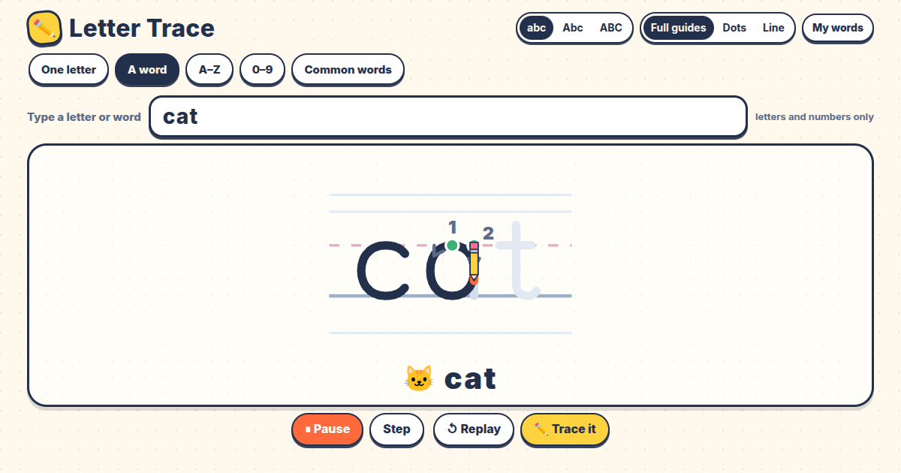

# Letter Trace

[](https://haptonstahl.org/letter-trace/)

A static, client-side handwriting practice toy for 1st–3rd graders and their
teachers. Pick a letter, a word, the whole alphabet, the digits, or a list of
common words; a pencil draws each letter stroke by stroke, then the child can
trace it with a finger or mouse.

Live at <https://haptonstahl.org/letter-trace/>.

## What is in here

| File | Purpose |
| --- | --- |
| `index.html` | The whole app: markup, styles, stroke data, and animation code. |
| `sw.js` | A tiny service worker that caches `index.html` so the page opens offline. |
| `preview.png` | The 1200×630 card used in this README and for link previews. |

Everything runs in the browser. There is no server-side code, no build step, no
npm install, no CDN, no fonts to download, and no data ever leaves the device.

## Features

- **Four ways to choose**: one letter (or digit), a typed word, A–Z, 0–9,
  common words, or a teacher's own list (`My words`).
- **Hand-built stroke data** for `A–Z`, `a–z`, and `0–9`, with stroke order,
  start dots, direction chevrons, and numbered strokes.
- **Play / pause / step / replay**, plus tap any letter to replay just that
  letter.
- **Trace mode**: after the demo, the child traces each stroke. Ink turns amber
  when the finger wanders, and the stroke locks in green when it is followed.
- **Case switch**: `abc`, `Abc`, or `ABC`.
- **Guide switch**: full handwriting guides, dots only, or just a baseline.
- **Common words** are shuffled once and the order is kept in `localStorage`, so
  forward/back always retraces the words the child has already seen. Entering
  the mode starts on a random word.
- **My words**: a teacher can paste a spelling list; it is stored on the device
  and also written into the address bar (`?words=cat,dog,sun`) so the list can be
  bookmarked or shared as a link.
- **Offline**: installed as a service worker cache on first visit.

## For teachers

1. Open <https://haptonstahl.org/letter-trace/> on whatever the room has — laptop,
   tablet, or phone. Nothing to install, no account, no ads.
2. Pick **One letter**, **A word**, **A–Z**, **0–9**, or **Common words**. Press
   **Play**, or **Step** to walk one stroke at a time.
3. Press **✏️ Trace it** and the child draws over the letter with a finger or mouse.
   Ink turns amber when the finger wanders off the stroke; the stroke turns green
   when it is followed.
4. **My words** holds this week's spelling list. Paste it, save, and the address
   bar becomes a link — `…/letter-trace/?words=cat,dog,sun` — that you can
   bookmark, project, or send to the class. The list is kept on each device, so
   the link is how you move it between devices.
5. A shared link opens straight into that list. Once the page has loaded once it
   also opens without wifi.

## The `?words=` parameter

`https://haptonstahl.org/letter-trace/?words=cat,dog,sun`

- Words are separated by commas (spaces or `;` also work), max 200 words,
  12 characters each, letters and digits only.
- The link seeds **My words** and opens that tab. Duplicates are dropped
  case-insensitively, and the list is saved on the device as well.
- Saving a list in the app rewrites the address bar to match, so the URL is
  always the thing to share.

## Deploying

The site is just files, served from `~/public_html/letter-trace/` on
`haptonstahl.org` (the account's web root is `/home3/srh/public_html/`, shared
with `kid-texto`). Deploy with:

```sh
rsync -av --delete index.html sw.js preview.png hap.org:public_html/letter-trace/
```

The app uses only relative URLs, so it works from any subdirectory. Serve it
over `http(s)` — `file://` works for the tracing, but service workers (offline)
are only allowed on `http://localhost` or a real `https://` origin.

Preview locally from this folder:

```sh
python3 -m http.server 8000
# open http://localhost:8000/
```

When `index.html` changes, bump `CACHE` in `sw.js` (e.g. `letter-trace-v3`).
Otherwise a returning visitor keeps the older cached copy until the background
refresh catches up.

When `index.html` changes, bump `CACHE` in `sw.js` (e.g. `letter-trace-v3`).
Otherwise a returning visitor keeps the older cached copy until the background
refresh catches up.

## How it works

Each glyph is a list of SVG path strings in a shared coordinate system:

```
ascender 14 ─  cap 24 ─  x-height 44 ─  baseline 74 ─  descender 96
```

Strokes are drawn in array order. The animation uses the browser's
`getTotalLength()` / `getPointAtLength()` to find the pencil position along a
stroke, and `stroke-dasharray` to reveal it. The same sampled points are used to
decide whether a finger is following the stroke in trace mode.

Letters are laid out into ruled rows and wrapped at about 430 units, so long
words become multi-row handwriting sheets rather than shrinking to fit.

## Browser support

Any current Chrome, Edge, Safari, or Firefox. The service worker needs
`http(s)`; everything else works without it.

## License

MIT — see [LICENSE](LICENSE). Use it, copy it, put it on your classroom site.

Reviewed, edited, or generated with deterministic and AI tools.
